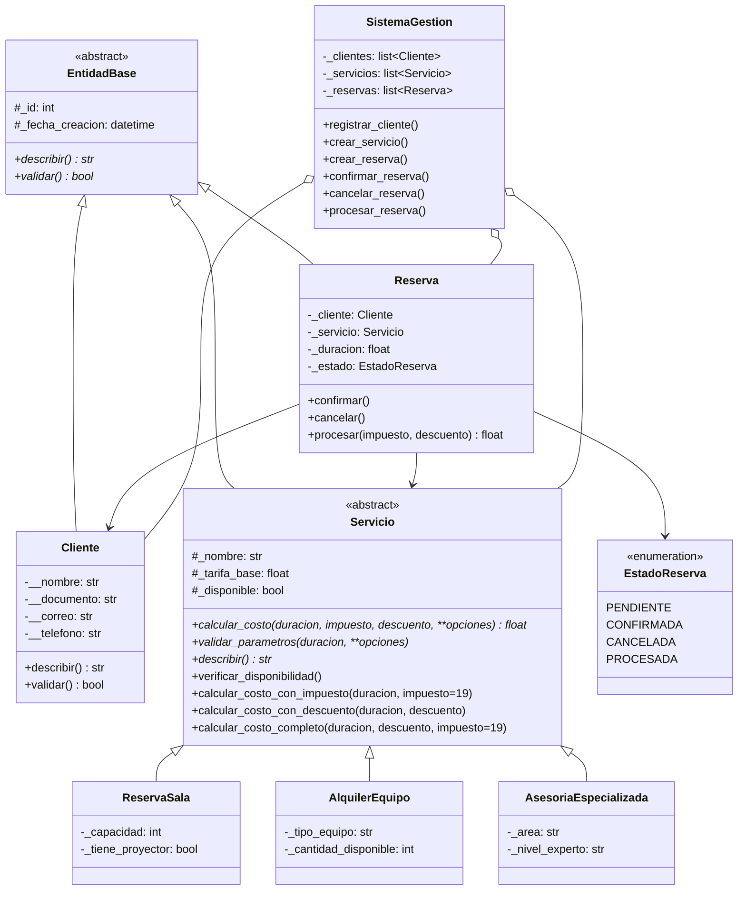

# Software FJ – Sistema Integral de Gestión de Clientes, Servicios y Reservas

Sistema orientado a objetos en **Python 3**, **sin bases de datos**, que gestiona los clientes, servicios y reservas de la empresa ficticia **Software FJ**. La empresa ofrece reservas de salas, alquiler de equipos y asesorías especializadas.

El objetivo es demostrar un **manejo robusto de excepciones**: el sistema registra cada error en un archivo de logs y **sigue funcionando** aunque reciba datos inválidos o se intenten operaciones no permitidas.

## Datos académicos

| | |
|---|---|
| **Universidad** | Universidad Nacional Abierta y a Distancia – UNAD |
| **Escuela** | Ciencias Básicas, Tecnología e Ingeniería (ECBTI) |
| **Programa** | Ingeniería de Sistemas |
| **Curso** | Programación – 213023 |
| **Actividad** | Fase 4 – Componente práctico (Prácticas simuladas) |
| **Estudiante** | Lorenis Paternina |
| **Grupo** | 213023_56 |
| **Tutor** | Alexander Lopez Tellez |

## Requisitos y ejecución

- Python **3.10 o superior**.
- No requiere instalar nada: solo usa la librería estándar (`abc`, `logging`, `re`, `enum`, `datetime`).

```bash
git clone https://github.com/lorenispaternina256/software-fj-fase4.git
cd software-fj-fase4
python main.py
```

Al terminar, el detalle de cada operación queda en `logs/sistema.log`.

## Estructura del proyecto

```
software-fj-fase4/
├── main.py                 # Punto de entrada: ejecuta las simulaciones
├── requirements.txt        # Sin dependencias externas
├── docs/
│   └── ejemplo_sistema.log # Log de ejemplo de una ejecución completa
├── logs/                   # Aquí se genera sistema.log al ejecutar
└── src/
    ├── excepciones.py      # Jerarquía de excepciones personalizadas
    ├── logger_config.py    # Configuración del logging
    ├── entidad_base.py     # Clase abstracta EntidadBase
    ├── cliente.py          # Clase Cliente (encapsulada y validada)
    ├── servicios.py        # Servicio (abstracta) + 3 servicios especializados
    ├── reserva.py          # Clase Reserva + Enum EstadoReserva
    └── sistema.py          # SistemaGestion: listas internas y operaciones seguras
```

## Diagrama de clases



## Manejo de excepciones

### Jerarquía de excepciones personalizadas

```
SoftwareFJError (Exception)            ← base de todas, con código de error
├── ValidacionError                     ← datos inválidos (guarda el campo)
│   ├── ClienteInvalidoError
│   └── ParametroFaltanteError
├── ServicioError
│   ├── ServicioNoDisponibleError
│   └── ParametroServicioInvalidoError
├── ReservaError
│   ├── ReservaInvalidaError
│   └── OperacionNoPermitidaError
└── CalculoInconsistenteError
```

### Dónde se usa cada bloque

| Bloque | Ubicación | Propósito |
|---|---|---|
| `try/except` | `Cliente.telefono`, `Servicio._validar_tarifa`, `Servicio._aplicar_ajustes`, `SistemaGestion.crear_servicio` | Captura errores técnicos (`ValueError`, `TypeError`) y los traduce a errores del dominio. |
| `try/except/else/finally` | `SistemaGestion._ejecutar` | Ejecuta cada operación pública. `except` registra el fallo, `else` registra el éxito y `finally` deja constancia de que la operación terminó. |
| `try/except/else/finally` | `Reserva.procesar` | `else` cambia el estado a PROCESADA solo si el cálculo fue correcto. `finally` registra siempre el intento. |
| `try/except/else` | `main.demostrar_polimorfismo`, `main.demostrar_sobrecarga` | `else` muestra el costo solo si no hubo error. |
| `try/finally` | `main.main`, `logger_config.cerrar_logger` | Garantiza que el cierre de la ejecución se registre y que el archivo de log se libere, pase lo que pase. |
| Encadenamiento `raise ... from` | `Cliente.telefono` (ValueError → ClienteInvalidoError), `Servicio._validar_tarifa`, `crear_servicio` (TypeError → ParametroServicioInvalidoError), `Reserva.__init__` (ParametroServicioInvalidoError → ReservaInvalidaError), `Reserva.procesar` (CalculoInconsistenteError → ReservaInvalidaError) | Conserva la causa original. El log registra el error y su causa. |

`SistemaGestion._ejecutar` incluye además una red de seguridad final que registra con traza completa (`logger.exception`) cualquier error no previsto. Así la aplicación **nunca se detiene**.

## Simulaciones

`main.py` ejecuta **26 simulaciones** en secuencia. Ningún fallo detiene las siguientes.

| # | Operación | Resultado esperado |
|---|---|---|
| 1 | Registrar cliente válido (Ana) | ✅ Éxito |
| 2 | Registrar otro cliente válido (Carlos) | ✅ Éxito |
| 3 | Cliente con correo inválido (`ana@`) | ❌ `ClienteInvalidoError` |
| 4 | Cliente con documento con letras | ❌ `ClienteInvalidoError` |
| 5 | Cliente con parámetro faltante (`None`) | ❌ `ParametroFaltanteError` |
| 6 | Cliente con teléfono con letras | ❌ `ClienteInvalidoError` (encadenada desde `ValueError`) |
| 7 | Cliente con documento duplicado | ❌ `ClienteInvalidoError` |
| 8 | Crear `ReservaSala` válida | ✅ Éxito |
| 9 | Crear `AlquilerEquipo` válido | ✅ Éxito |
| 10 | Crear `AsesoriaEspecializada` válida | ✅ Éxito |
| 11 | Servicio con tarifa negativa | ❌ `ParametroServicioInvalidoError` |
| 12 | Asesoría con nivel inexistente | ❌ `ParametroServicioInvalidoError` |
| 13 | Servicio con parámetros faltantes | ❌ `ParametroServicioInvalidoError` (encadenada desde `TypeError`) |
| 14 | Crear una segunda sala | ✅ Éxito |
| 15 | Reserva válida: crear, confirmar y procesar con IVA 19 % | ✅ Éxito |
| 16 | Reservar un servicio no disponible | ❌ `ServicioNoDisponibleError` |
| 17 | Reserva con duración 0 | ❌ `ReservaInvalidaError` |
| 18 | Reserva con duración negativa | ❌ `ReservaInvalidaError` |
| 19 | Reserva para un cliente inexistente | ❌ `ReservaInvalidaError` |
| 20 | Reserva que supera la capacidad de la sala | ❌ `ReservaInvalidaError` (encadenada) |
| 21 | Alquilar más equipos de los disponibles | ❌ `ServicioNoDisponibleError` |
| 22 | Cancelar una reserva ya cancelada | ❌ `OperacionNoPermitidaError` |
| 23 | Procesar con descuento del 150 % | ❌ `ReservaInvalidaError` (encadenada desde `CalculoInconsistenteError`) |
| 24 | Procesar la misma reserva con 10 % de descuento + IVA | ✅ Éxito |
| 25 | Confirmar una reserva ya procesada | ❌ `OperacionNoPermitidaError` |
| 26 | Procesar una reserva sin confirmar | ❌ `OperacionNoPermitidaError` |

Después de las simulaciones, el programa muestra el **polimorfismo**: recorre todos los servicios llamando `describir()` y `calcular_costo()`. También muestra las **variantes sobrecargadas** del cálculo de costo y termina con un resumen de operaciones exitosas y fallidas.

## Ejemplo de salida del log

Archivo completo de ejemplo: [`docs/ejemplo_sistema.log`](docs/ejemplo_sistema.log).

```
2026-11-03 16:39:18 | INFO     | software_fj.main | === Simulación 6: Registrar cliente con teléfono con letras (error encadenado) ===
2026-11-03 16:39:18 | WARNING  | software_fj.src.sistema | FALLO - Registrar cliente 'Sofía Mora' -> ClienteInvalidoError: [CLI-001] El teléfono '300ABC4567' debe contener solo números (campo: telefono)
2026-11-03 16:39:18 | WARNING  | software_fj.src.sistema |    Causa original: ValueError: invalid literal for int() with base 10: '300ABC4567'
2026-11-03 16:39:18 | INFO     | software_fj.src.sistema | Fin de la operación: Registrar cliente 'Sofía Mora'
2026-11-03 16:39:18 | INFO     | software_fj.src.reserva | Intento de procesamiento de la reserva #14 finalizado (estado actual: Confirmada)
2026-11-03 16:39:18 | ERROR    | software_fj.src.sistema | FALLO - Procesar reserva #14 (impuesto=19, descuento=150) -> ReservaInvalidaError: [RES-001] No se pudo procesar la reserva #14: cálculo inconsistente
2026-11-03 16:39:18 | ERROR    | software_fj.src.sistema |    Causa original: CalculoInconsistenteError: [CAL-001] Descuento inválido: 150.0% (debe estar entre 0 y 100)
```

Niveles usados: `INFO` para los eventos, `WARNING` para los datos inválidos rechazados y `ERROR` para los errores de servicio, reserva o cálculo.

## Pilares de la POO aplicados

| Pilar | Aplicación en el proyecto |
|---|---|
| **Abstracción** | `EntidadBase` y `Servicio` son clases abstractas (`abc.ABC`) con métodos `@abstractmethod`. Definen *qué* debe hacer una entidad o un servicio sin decir *cómo*. |
| **Herencia** | `Cliente`, `Servicio` y `Reserva` heredan id, fecha y `__str__` de `EntidadBase`. Los tres servicios heredan validaciones, disponibilidad y variantes de costo de `Servicio`. |
| **Polimorfismo** | `calcular_costo`, `describir` y `validar_parametros` se sobrescriben en cada servicio. `Reserva.procesar()` llama `calcular_costo()` sin saber qué tipo de servicio tiene. `AlquilerEquipo` sobrescribe además `verificar_disponibilidad`. |
| **Encapsulación** | `Cliente` guarda sus datos en atributos privados (`__nombre`, `__documento`...) y los expone con `@property`. Los *setters* validan cada dato. `SistemaGestion` entrega copias de sus listas internas. |

### Sobrecarga de métodos en Python

Python no admite varias funciones con el mismo nombre y distinta firma. La sobrecarga se simula de dos formas:

1. **Parámetros opcionales** en `calcular_costo(duracion, impuesto=None, descuento=None, **opciones)`.
2. **Métodos variantes**: `calcular_costo_con_impuesto`, `calcular_costo_con_descuento` y `calcular_costo_completo`, que reutilizan el cálculo base.

## Almacenamiento

Toda la información vive en **objetos y listas en memoria** (`SistemaGestion._clientes`, `_servicios` y `_reservas`). El único archivo que escribe el sistema es `logs/sistema.log`, que guarda los eventos y los errores.
